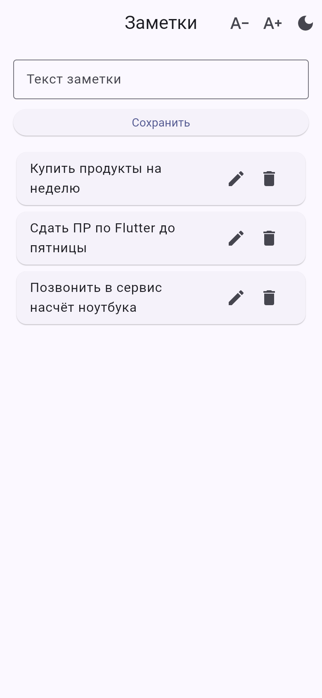
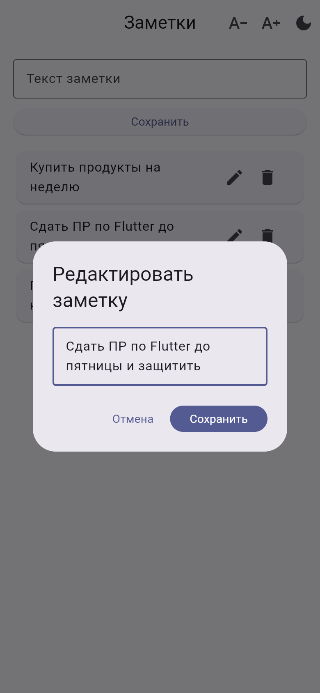
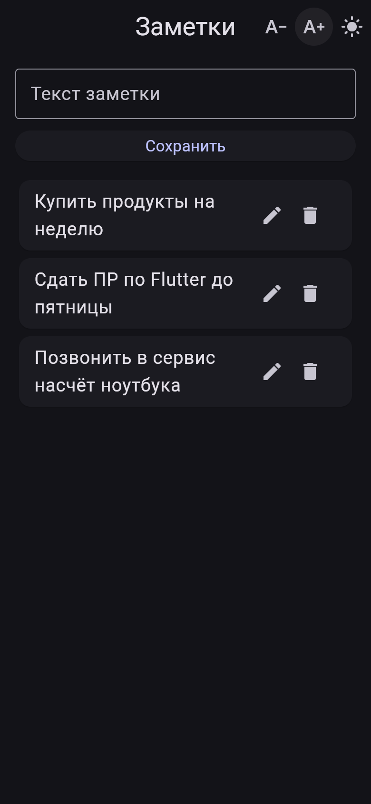

# pr2_flutter

Приложение «Заметки» на Flutter с управлением состоянием через Cubit · *Notes app in Flutter with Cubit state management*

`Flutter` `Dart` `flutter_bloc (Cubit)` `Material 3`

<p align="center">
  
  
  
</p>

## Что сделано
- **Заметки:** добавление, редактирование в отдельном диалоге, удаление. Пустые заметки и пробелы по краям отсекаются
- **Управление состоянием на Cubit** (`flutter_bloc`):
  - `NotesCubit` хранит неизменяемый список заметок и на каждое действие выдаёт новый список;
  - интерфейс перестраивается через `BlocBuilder`
- **Настройки отображения в отдельном `ThemeCubit`:**
  - переключение светлой и тёмной темы;
  - размер шрифта на всё приложение от 0,8× до 1,4× через `TextScaler`
- Оба Cubit создаются один раз в `MultiBlocProvider` и доступны всему приложению
- **Тесты:**
  - юнит-тесты для `NotesCubit` и `ThemeCubit`;
  - виджет-тест полного сценария: добавить, отредактировать, удалить

История: первый коммит — сданная версия ПР2 на `setState`. Второй — доработка по заданию на паре: перенос состояния в Cubit, тема, размер шрифта и тесты.

## Структура
```
lib/
├── main.dart                # приложение, экран заметок, диалог редактирования
└── cubit/
    ├── notes_cubit.dart     # список заметок: добавить, изменить, удалить
    ├── theme_cubit.dart     # тема и масштаб шрифта
    └── theme_state.dart     # неизменяемое состояние темы с copyWith
test/
├── notes_cubit_test.dart
├── theme_cubit_test.dart
└── widget_test.dart         # сценарий добавить → изменить → удалить
```

## Запуск
```bash
flutter pub get
flutter run
flutter test
```

---

## English

A Flutter notes app with Cubit state management.

### Features
- **Notes:** add, edit in a dialog, delete. Empty notes and surrounding whitespace are rejected
- **Cubit state management** (`flutter_bloc`):
  - `NotesCubit` keeps an immutable list and emits a new one on every change;
  - the UI rebuilds through `BlocBuilder`
- **Display settings in a separate `ThemeCubit`:**
  - light/dark theme toggle;
  - app-wide font scale from 0.8× to 1.4× via `TextScaler`
- Both cubits are created once in a `MultiBlocProvider`
- **Tests:**
  - unit tests for both cubits;
  - a widget test for the full add → edit → delete flow

History: the first commit is the submitted `setState` version. The second is an in-class extension: state moved to Cubit, theme, font size and tests.

### Structure
```
lib/main.dart                 app, notes screen, edit dialog
lib/cubit/notes_cubit.dart    notes list: add, edit, delete
lib/cubit/theme_cubit.dart    theme and font scale
lib/cubit/theme_state.dart    immutable theme state with copyWith
test/                         cubit unit tests and a widget test
```

### Run
```bash
flutter pub get
flutter run
flutter test
```
